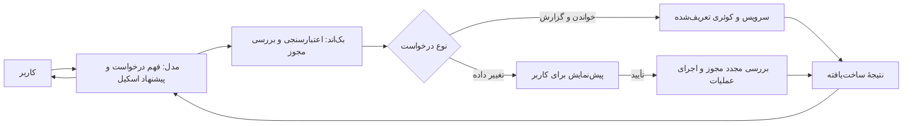

# طرح دستیار و سرویس هوش مصنوعی

> **وضعیت: پیش‌نویس برای گفت‌وگو، نه طرح نهایی یا قابلیت منتشرشده.** این سند ایده‌ها و گزینه‌های مطرح‌شده برای دستیار Quire را یک‌جا نگه می‌دارد. توصیه‌ها نیازمند تصمیم محصول و بررسی فنی‌اند. وضعیت واقعی محصول و معماری در [PRODUCT_OVERVIEW.md](./PRODUCT_OVERVIEW.md)، [FRONTEND.md](./FRONTEND.md) و [BACKEND.md](./BACKEND.md) ثبت می‌شود. پیش از پیاده‌سازی هر مفهوم مصوب، ابتدا اسناد مرجع طبق [AGENTS.md](../AGENTS.md) به‌روزرسانی شوند.

## ۱. هدف

کاربر با زبان طبیعی به دستیار می‌گوید چه می‌خواهد: «یک تسک با این توضیحات بساز»، «وضعیت این تسک را تغییر بده» یا «گزارش تیم در ماه گذشته را بده». مدل درخواست را می‌فهمد، اطلاعات ناقص را می‌پرسد و یک درخواست ساخت‌یافته پیشنهاد می‌کند. نرم‌افزار ورودی، هویت، محدوده و مجوزهای کاربر را بررسی می‌کند و عملیات یا گزارش مجاز را اجرا می‌کند.

این لایه از نظر تجربه مانند مجموعه‌ای از دستورات مشخص عمل می‌کند؛ برای اجرای آن نیازی به دادن دسترسی Bash، ترمینال، SQL آزاد یا دسترسی مستقیم مدل به دیتابیس نیست. پاسخ گزارش باید بر اعداد حاصل از برنامه تکیه کند و محدودیت داده را روشن بگوید.

## ۲. منظور از «اسکیل»

در این سند **اسکیل** یک قابلیت مشخص برنامه با قرارداد ورودی و خروجی، قواعد اعتبارسنجی، مجوز و تابع اجرای سمت بک‌اند است؛ مثلاً ساخت تسک یا گزارش ماهانه. این مفهوم به معنی نصب اسکیل‌های محیط Codex روی سرور نیست. اسکیل‌ها از سرویس‌های دامنهٔ برنامه استفاده می‌کنند تا قوانین تسک، تیکت و دسترسی برای رابط عادی و دستیار یکسان بمانند.

## ۳. وضعیت فعلی و فاصله تا هدف

- در کد محلی، گفت‌وگو از مسیر `POST /api/v1/assistant/chat` و سرویس Nokod با مدل `Qwen38` استفاده می‌کند. کلید ارائه‌دهنده در بک‌اند است و تاریخچهٔ گفتگو در state مرورگر می‌ماند.
- کد محلی فعلی می‌تواند پیشنهاد ساخت تسک و تیکت و ویرایش برخی فیلدهای تسک را در فرانت اعتبارسنجی و پس از تأیید از API معمول کاربر اجرا کند. گزارش فعلی شمارش وضعیت فعلی تسک‌های اصلی قابل‌دسترسی است؛ گزارش تاریخی ماهانه یا زمان شخصی نیست. **وجود کد محلی به معنی انتشار و فعال بودن آن روی سرور نیست.**
- اجرای اسکیل‌ها و بخشی از تصمیم‌های دستیار اکنون در فرانت است. هدف پیشنهادی، انتقال قرارداد، اعتبارسنجی، بررسی مجوز، اجرای عملیات و گزارش به بک‌اند است؛ رابط مسئول گفتگو و تأیید باقی می‌ماند.
- در پیاده‌سازی فعلی، `canAccessProject` عضویت کاربر در سازمان صاحب پروژه را بررسی می‌کند. عضویت مستقل پروژه و مجوزهای مستقل ساخت و ویرایش تسک در API اعمال نشده‌اند. برای تحقق دقیق دسترسی مورد انتظار، ابتدا باید مدل مجوز مصوب و در APIهای عادی و دستیار یکسان اجرا شود.
- مسئولان تسک فعلاً با نام در JSON ذخیره می‌شوند. مجموع `time_spent_minutes` روی خود تسک است و به شخص یا بازهٔ زمانی تفکیک نمی‌شود. `organization_activity` ساخت تسک، تغییر وضعیت و کامنت را ثبت می‌کند؛ این داده جای یک سامانهٔ کامل ثبت زمان شخصی را نمی‌گیرد. رویدادهای تیکت نیز در `ticket_activity` وجود دارند. کیفیت و پوشش تاریخی رویدادها باید پیش از استفاده در گزارش بررسی شود.

## ۴. گزینه‌های معماری

| گزینه | نحوهٔ کار | مزیت | هزینه یا محدودیت |
|---|---|---|---|
| JSON و فهرست اسکیل در بک‌اند | مدل نام اسکیل و آرگومان را پیشنهاد می‌کند؛ بک‌اند فقط اسکیل‌های ثبت‌شده را اعتبارسنجی و اجرا می‌کند. | ساده، روشن و مناسب اندازهٔ فعلی پروژه | برای کلاینت‌های خارجی بعداً رابط سازگار جداگانه لازم می‌شود. |
| ابزارهای مدل با قرارداد استاندارد | قرارداد اسکیل‌ها به ارائه‌دهنده معرفی می‌شود و مدل درخواست فراخوانی ابزار می‌دهد؛ اجرای واقعی همچنان در بک‌اند است. | مناسب گفتگوهای چندمرحله‌ای و معرفی صریح ورودی‌ها | قابلیت و رفتار tool calling مدل و سرویس فعلی باید جداگانه تأیید شود؛ وابستگی به قالب ارائه‌دهنده بیشتر است. |
| سرویس مستقل ابزار، مثلاً MCP | همان قابلیت‌های دامنه از طریق یک سرویس استاندارد در دسترس دستیار و کلاینت‌های دیگر قرار می‌گیرند. | مناسب استفادهٔ چند برنامه یا عامل بیرونی | استقرار، احراز هویت، دسترسی و نگه‌داری مستقل بیشتری می‌خواهد. |

**پیشنهاد فعلی:** با JSON و اسکیل‌های ثبت‌شده در بک‌اند آغاز کنیم. مرز بین قرارداد اسکیل و اتصال مدل روشن باشد تا در صورت نیاز بتوان بعداً ابزار استاندارد یا MCP را روی همان سرویس‌های دامنه قرار داد. این پیشنهاد هنوز تصمیم نهایی نیست.

## ۵. جریان پیشنهادی



۱. کاربر درخواست می‌دهد؛ مدل در صورت ابهام، اطلاعات لازم را می‌پرسد.
۲. مدل نام یک اسکیل مجاز و آرگومان‌ها را پیشنهاد می‌کند. شناسه‌ها باید به موجودیت‌های واقعی و قابل‌دسترسی تطبیق داده شوند؛ نام مشابه یا مبهم نیاز به پرسش دارد.
۳. بک‌اند هویت را از نشست معتبر می‌گیرد، نه از متن پیام یا آرگومان مدل. نوع داده، فیلدهای مجاز، محدودهٔ پروژه و مجوز را بررسی می‌کند.
۴. اسکیل فقط‌خواندنی در صورت مجاز بودن اجرا می‌شود. برای عملیات تغییردهنده، پیش‌نمایش شامل موجودیت و مقادیر واقعی قبل و بعد به کاربر نمایش داده می‌شود.
۵. تأیید به **همان کاربر، همان عملیات و همان آرگومان‌های نمایش‌داده‌شده** متصل و محدود به زمان باشد. هنگام تأیید، بک‌اند دسترسی و اعتبار وضعیت را دوباره بررسی کند. اگر دادهٔ مؤثر عوض شده، پیش‌نمایش تازه لازم است. بررسی وضعیت و اعمال تغییر باید تا جای ممکن در یک مرز اتمیک انجام شود.
۶. یک شناسهٔ درخواست یکتا مانع ساخت تکراری در تلاش مجدد شود. نتیجه یا خطا به شکل ساخت‌یافته برگردد؛ مدل بدون نتیجهٔ موفق ادعای انجام عملیات نکند. ثبت رویداد شامل عامل واقعی، زمان و نتیجه باشد.

اسکیل‌ها هویت یا مجوز بیشتری از کاربر ندارند. پاسخ دستیار، متن اسناد، نام پروژه و خروجی ابزارها دادهٔ غیرقابل‌اعتمادند و نمی‌توانند مجوز یا دستور سیستمی را تغییر دهند. طراحی دقیق حفاظت از تأیید، نشست، تکرار و رقابت درخواست‌ها بخشی از پیاده‌سازی است.

## ۶. نمونهٔ قراردادهای پیشنهادی

نمونه‌ها برای گفت‌وگو هستند و API نهایی یا موجود محسوب نمی‌شوند. شناسه‌ها نمایشی‌اند.

### ساخت تسک

```json
{
  "skill": "task.create",
  "arguments": {
    "project_id": "project-123",
    "title": "طراحی صفحه ورود",
    "description": "طراحی نسخه موبایل",
    "assignee_ids": ["user-456"],
    "priority": "high"
  }
}
```

بک‌اند عضویت و مجوز درخواست‌کننده در پروژه، مجاز بودن مسئولان و فیلدها را بررسی می‌کند. مسئولِ اعلام‌شده با عامل عملیات یکی نیست: عامل همیشه از نشست می‌آید. پیش از ساخت، جزئیات به کاربر نشان داده می‌شود.

### گزارش ماهانهٔ تیم

```json
{
  "skill": "report.team_monthly",
  "arguments": {
    "organization_id": "org-123",
    "from": "2026-10-01",
    "to": "2026-11-01"
  }
}
```

در این مثال بازه شامل شروع و **غیرشامل پایان** است. این تنها نمونهٔ قالب است؛ نوع بازه، تقویم، منطقهٔ زمانی و قواعد دسترسی به گزارش باید مصوب شوند. بک‌اند کوئری‌های مشخص و پارامتری‌شده را بر پایهٔ داده‌های مجاز اجرا می‌کند؛ مدل SQL آزاد ارسال نمی‌کند.

### شکل پیشنهادی نتیجه

```json
{
  "skill": "report.team_monthly",
  "period": { "from": "2026-10-01", "to": "2026-11-01" },
  "scope": { "organization_id": "org-123" },
  "metrics": { "tasks_created": 12, "tasks_completed_in_period": 8 },
  "limitations": ["زمان شخصی برای این بازه ثبت نشده است"]
}
```

مقادیر صرفاً نمونه‌اند. نام نهایی فیلدها، خطاها و قالب نسخه‌بندی باید هنگام طراحی API قطعی شوند. گزارش باید مشخص کند چه داده‌ای شمرده شده و چه داده‌ای در دسترس نبوده است.

## ۷. اسکیل‌های پیشنهادی نسخهٔ نخست

| اسکیل | مسئولیت | تأیید پیش از اجرا |
|---|---|---|
| `task.create` | دریافت اطلاعات لازم و ساخت تسک در پروژهٔ مجاز | بله |
| `task.update` | انتخاب تسک مجاز و تغییر فیلدهای مشخص با نمایش قبل/بعد | بله |
| `task.list` | جست‌وجو و فهرست تسک‌های قابل‌مشاهده با فیلترهای تعریف‌شده | خیر؛ بررسی دسترسی لازم است |
| `ticket.create` | ساخت تیکت با فیلدهای مجاز | بله |
| `report.team_monthly` | محاسبهٔ شاخص‌های مصوب برای تیم و بازهٔ مجاز | خیر؛ بررسی دسترسی لازم است |

این نام‌ها و ترتیب، پیشنهادند. حذف تسک، ویرایش تیکت و عملیات گروهی هنوز در دامنهٔ نسخهٔ نخست تصویب نشده‌اند. هر اسکیل باید فیلدهای مجاز، قواعد دامنه، مجوز و خطاهای خودش را صریح تعریف کند.

## ۸. گزارش کارکرد و داده‌های لازم

«وضعیت فعلی» با «رخداد در بازه» متفاوت است. مثلاً تعداد تسک‌هایی که امروز تکمیل هستند با تعداد تسک‌هایی که در ماه گذشته تکمیل شدند برابر نیست. چندمسئولی بودن تسک نیز به معنی انجام کامل همان کار توسط هر مسئول نیست.

شاخص‌های پیشنهادی برای بحث:

- تسک‌های ساخته‌شده در بازه، با تعریف اینکه شمارش بر اساس سازنده است یا پروژه.
- گذارهای معتبر به وضعیت تکمیل در بازه؛ تکمیل دوباره پس از بازگشایی باید تعریف مشخصی داشته باشد.
- تسک‌های باز و وضعیت فعلی در زمان تهیهٔ گزارش، جدا از شاخص‌های تاریخی.
- زمان ثبت‌شده توسط هر فرد در بازه، پس از اضافه شدن رکوردهای زمان با کاربر، تسک، مقدار و زمان ثبت/بازهٔ مربوط.

برای گزارش زمان شخصی به دادهٔ پایدار تفکیک‌شده بر اساس شخص و تاریخ نیاز است. مجموع فعلی زمان هر تسک را نمی‌توان با اطمینان به فرد یا ماه اختصاص داد؛ نباید مقدار فاقد داده را صفر قطعی یا عدد بازسازی‌شده وانمود کرد. رویدادهای گذشته نیز ممکن است پوشش کامل نداشته باشند. گزارش باید بازه، منطقهٔ زمانی، محدودهٔ قابل‌دسترسی، وضعیت کامل‌بودن داده و تعریف شاخص‌ها را نشان دهد. اگر کاربر فقط به بخشی از تیم یا پروژه‌ها دسترسی دارد، گزارش باید همین محدوده را روشن کند.

ثبت زمان جدید و تغییر مدل مسئولان احتمالاً به migration تازه و هماهنگی رابط و API نیاز دارد. جزئیات مدل، داده‌های پیشین، بازه‌های هم‌پوشان، ویرایش زمان و قواعد محاسبه هنوز تصمیم‌گیری نشده‌اند؛ migration اجراشده نباید ویرایش شود.

## ۹. برنامهٔ پیشنهادی اجرا پس از توافق

۱. **محصول و مجوزها:** مصوب‌کردن سطح دسترسی پروژه و مجوزهای مشاهده، ساخت و ویرایش؛ تعیین دسترسی به گزارش فردی و تیمی. سپس بررسی و اصلاح APIهای معمول تا دستیار و رابط عادی از همان قواعد پیروی کنند.
۲. **بنیاد سمت بک‌اند:** قرارداد اسکیل‌ها و نتیجه‌ها، ثبت اسکیل‌های مجاز، اعتبارسنجی ورودی، اتصال به نشست، بررسی دسترسی، خطاهای واضح و ثبت عامل و نتیجه. مدل هیچ دسترسی مستقیم به shell یا دیتابیس نمی‌گیرد.
۳. **تأیید و اجرای امن:** پیش‌نمایش دقیق، تأیید محدود به عملیات و کاربر، بررسی مجدد هنگام اجرا، کنترل تداخل و جلوگیری از تکرار. قوانین دامنه از طریق سرویس‌های مشترک اجرا شوند.
۴. **اتصال گفتگو:** انتقال اجرای فعلی اسکیل‌ها از فرانت به بک‌اند؛ مدل فقط اسکیل مجاز را پیشنهاد می‌کند و رابط وضعیت پیشنهاد، درخواست توضیح، تأیید و نتیجه را نشان می‌دهد. اگر ارائه‌دهنده از ابزار استاندارد پشتیبانی قابل‌اتکا دارد، امکان استفاده از آن جداگانه بررسی شود.
۵. **داده و گزارش:** مصوب‌کردن شاخص‌ها و بازه، افزودن داده و migrationهای لازم برای زمان شخصی و رویدادهای موردنیاز، ساخت کوئری‌های تعریف‌شده و برگرداندن اعداد و محدودیت داده.
۶. **آزمون و انتشار:** آزمون سناریوهای کاربران مجاز و غیرمجاز، داده و پروژهٔ نامعتبر، نام مبهم، ورودی مخرب، لغو و انقضای تأیید، تغییر دسترسی یا تسک پیش از اجرا، تکرار درخواست، محاسبهٔ بازه و گزارش با دادهٔ ناقص. رفتار گفتگو، ثبت نتیجه و جدا بودن داده‌های آزمایشی نیز بررسی شوند؛ انتشار پس از آماده‌شدن نسخه و بازبینی جداگانه انجام شود.

## ۱۰. تصمیم‌های باز برای گفت‌وگو

- **معیار گزارش نخست:** فقط تعداد و وضعیت تسک‌ها یا همچنین ساعت واقعی هر عضو؟ پیشنهاد مطرح‌شده شامل هر دو است، با این محدودیت که زمان شخصی معتبر فقط از شروع ثبت جدید در دسترس خواهد بود.
- **دامنهٔ گزارش:** سازمان، تیم، پروژه یا مجموعه‌ای از پروژه‌ها؟ چه کسی اجازهٔ دیدن دادهٔ فرد دیگر را دارد و چگونه محدودبودن محدوده نمایش داده می‌شود؟
- **زمان:** «ماه گذشته» به معنی ماه تقویمی شمسی پیشین است یا ۳۰ روز گذشته؟ منطقهٔ زمانی، مرز روز و بازهٔ پایان چگونه تعیین شوند؟
- **معنای شاخص‌ها:** تعریف تکمیل، بازگشایی و تکمیل دوباره، سهم تسک چندمسئولی، ثبت و اصلاح زمان و نمایش داده‌های قدیمی ناقص چیست؟
- **مدل دسترسی:** مالک، مدیر و عضو به کدام پروژه‌ها و عملیات دسترسی دارند؟ آیا ساخت و ویرایش تسک مجوز مستقل می‌خواهند؟
- **تأیید عملیات:** پیش‌نمایش برای هر تغییر جدا باشد یا امکان تأیید مجموعهٔ تغییرات هم لازم است؟ مدت اعتبار و رفتار هنگام تغییر داده یا دسترسی چه باشد؟
- **حریم داده و ارائه‌دهنده:** چه بخش‌هایی از نام‌ها، توضیحات، نتایج و تاریخچه به مدل خارجی فرستاده شوند، و ثبت لاگ‌ها چه میزان جزئیات داشته باشد؟
- **مرز نسخهٔ اول:** کدام اسکیل‌ها و عملیات گروهی یا حذف بعداً اضافه شوند؟ آیا در آینده کلاینت بیرونی یا MCP واقعاً موردنیاز است؟
